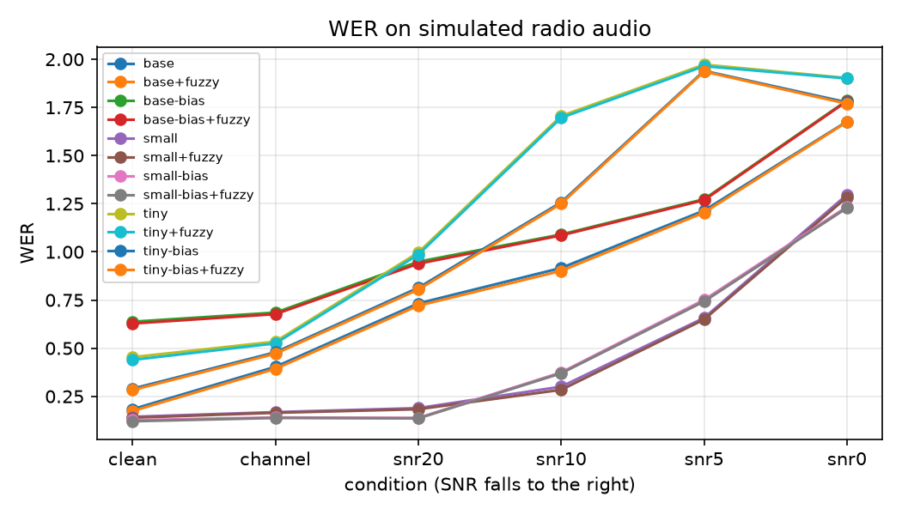
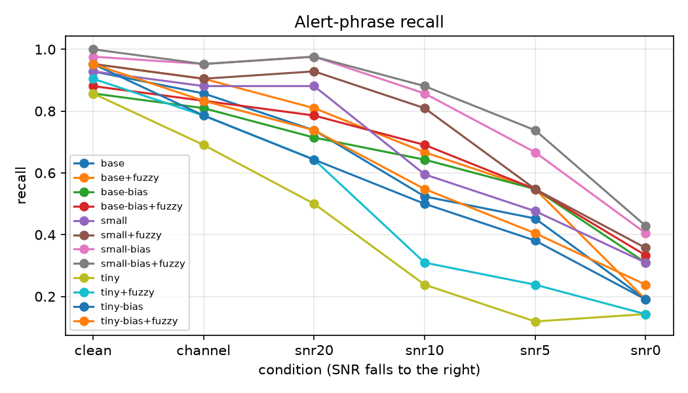
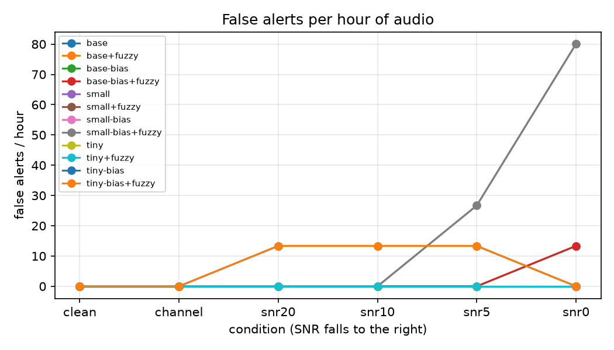

# radiobench

Radio-grade speech recognition with a built-in evaluation harness. It simulates narrowband, compressed, noisy public-safety radio audio, and measures how Whisper degrades on it and what recovers accuracy.

> **Limitations (read first)**
> 1. **The audio is simulated.** No real 911 or radio recordings are used. Speech is Piper TTS reading generated scripts; results show *relative* degradation, not field performance.
> 2. **Radio vocoders are only approximated.** P25 IMBE/AMBE is not reproduced; GSM 06.10 / AMR-NB (via ffmpeg) stand in for it.
>
> Also: the biasing lexicon (streets, codes) is the same list the scripts draw from, so biasing gains are an *upper bound*, representing an agency that knows its own gazetteer. TTS speech is cleaner and more regular than human speech.

## Architecture

```
scripts.py ─► tts.py (Piper, many speakers) ─► degrade.py ─► manifest.jsonl ─┐
LibriSpeech (clean sanity) ──────────────────────────────────────────────────┤
                                                                              ▼
                       asr.py (faster-whisper tiny/base/small ± prompt bias) ─► postcorrect.py (fuzzy lexicon)
                                                                              ▼
                       metrics.py (WER, keyword recall/precision, false alerts/hr, RTF) ─► report.py (CSV, MD, PNG)
```

**Degradation chain** (`degrade.py`, `ChannelConfig`): resample to 8 kHz → 300–3000 Hz band-pass → siren/wind/traffic noise at set SNR (ESC-50 clips, or synthetic generators if absent) → hard clipping → PTT squelch tail → GSM/AMR-NB codec → random dropouts. Seeded and deterministic.

**Conditions:** `clean`, `channel` (everything except noise), `snr20`, `snr10`, `snr5`, `snr0` (noise type rotates per utterance).

**Systems:** Whisper tiny/base/small baseline; same models with a domain prompt (`initial_prompt`); each optionally with fuzzy post-correction (`+fuzzy`) against the lexicon.

**Metrics:** WER (normalised: digits↔words, punctuation stripped); alert-phrase recall, precision and **false alerts per hour of audio**, reported separately because a miss and a false alarm cost differently; real-time factor and mean latency.

## Usage

```bash
pip install -e ".[tts,dev]"
pytest                                           # unit tests, no downloads needed
radiobench download --tts --librispeech --esc50  # Piper voice, LibriSpeech test-clean, ESC-50
radiobench build-dataset -n 300                  # scripts -> TTS -> all conditions
radiobench evaluate --config configs/default.yaml  # results/default/{results.csv,results.md,*.png}
radiobench degrade in.wav out.wav --snr 5 --noise siren   # try the simulator on any file
```

Each run is defined by one YAML file; transcripts are cached so runs resume and re-scoring is instant.

## Not implemented

* **LoRA fine-tune of whisper-small:** stretch goal; needs far more than the 4 GB GTX 1650 here comfortably allows for `small` (`base` might fit). Optional deps are listed under `[finetune]`.
* **Diarization error rate:** needs gated pyannote models and a user-supplied Hugging Face token.
* **Gradio demo:** optional.

## Results

60 utterances per condition (about 42 alert phrases each), radio set of simulated audio. Cell = WER / alert-phrase recall / false alerts per hour. Full table of all 12 variants: [docs/results.md](docs/results.md).

| system | clean | channel | 20 dB | 10 dB | 5 dB | 0 dB |
|:--|:--|:--|:--|:--|:--|:--|
| whisper-small | 14.4% / 93% / 0 | 16.8% / 88% / 0 | 18.9% / 88% / 0 | 30.0% / 60% / 0 | 65.7% / 48% / 0 | 129.7% / 31% / 0 |
| small + fuzzy correction | 13.9% / 95% / 0 | 16.5% / 90% / 0 | 18.3% / 93% / 0 | 28.4% / 81% / 0 | 64.9% / 55% / 0 | 128.4% / 36% / 0 |
| small + domain prompt | 12.6% / 98% / 0 | 14.0% / 95% / 0 | 13.8% / 98% / 0 | 37.4% / 86% / 0 | 75.1% / 67% / 26.7 | 123.4% / 40% / 80.1 |
| small + prompt + fuzzy | 12.1% / 100% / 0 | 13.8% / 95% / 0 | 13.6% / 98% / 0 | 37.0% / 88% / 0 | 74.3% / 74% / 26.7 | 122.8% / 43% / 80.1 |

LibriSpeech test-clean sanity WER: tiny 7.0%, base 6.6%, small 3.5%.

  

**Findings**
* Radio conditions are costly: whisper-small goes from 14% WER (clean TTS) to 30% at 10 dB and 66% at 5 dB. Tiny and base degrade far earlier (WER above 100% means hallucinated insertions on noise).
* Domain prompt + fuzzy correction raised alert-phrase recall from 60% to 88% at 10 dB and from 48% to 74% at 5 dB (small).
* The trade-off: below 10 dB the prompt *worsens* WER (5 dB: 65.7% to 75.1%) and produces false alerts (26.7/hr at 5 dB, 80.1/hr at 0 dB). Fuzzy correction alone added none here.

**Caveats on these numbers**
* Small sample (60 utterances/condition): recall carries roughly +/-12 points; one false alert shows as 13/hr. Differences under ~10 points are noise.
* With the prompt, tiny and base fall into repetition loops on 911-style calls ("9-1-1-1-1..."); decoding ran at fixed temperature 0, which disables Whisper's fallback. Their bias rows are therefore pessimistic. Small is unaffected.
* Latency / real-time-factor figures are not reported: the run was interrupted and resumed under varying load, so timings are unreliable.
